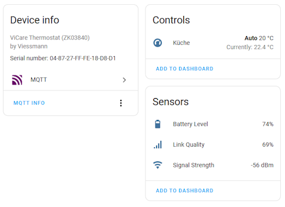
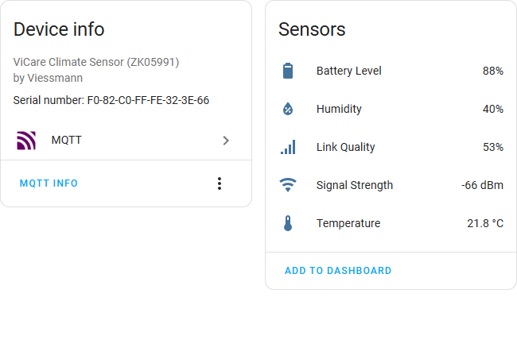

# **ViLocal** /  Local integration of Viessmann ViCare into MQTT + Home Assistant Device Discovery

 

> [!IMPORTANT]
> Neither this project, nor its author(s) have any affiliation with Viessmann (Group GmbH & Co. KG), ViCare, its products, or subsidiaries in any way, shape, or form. The projects efforts have been solely achieved through reverse engineering and by making use of the public / open source ZigBee specification. Whilst the goal of this project was, to provide local access to ViCare networks without interfering with the inner workings of the ViCare system, no warranty or guarantee can be given or provided. Use this project entirely at your own risk. There is no financial or commercial interest behind this work.

> [!TIP]
> ViLocal is also available as a [**Home Assistant App Version**, feel free to check it out](https://github.com/kristian/ViLocal-ha_app)!

> [!NOTE]
> This project is based on the open-source [ZigBee Toolkit for Node.js](https://www.npmjs.com/package/zbtk).

## Introduction

**Welcome!** This project aims to make smart home components of [Viessmann's ViCare](https://www.viessmann.de/de/produkte/steuerung-und-konnektivitaet/vicare-app/komponenten.html), like thermostat vales (TRVs) and climate (temperature / humidity) sensors available for local use, without requiring any connection to the Viessmann servers / APIs and / or the internet. Viessmann has been [particularly "hesitant"](https://community.viessmann.de/t5/Getting-started-programming-with/Home-Assistant-Integration-von-ViCare-Sensoren-und-ViCare/m-p/521061) providing local access to ViCare components. This resulted in being stuck either not integrating the components into home automation (like Home Assistant), or buying into their paid API plans, starting with the very expensive "Advanced API" subscription, to be able to get access to the components, whilst still being stuck to internet-only access to the components trough their API.

Due to the [zero-install](https://yarnpkg.com/features/caching#zero-installs) approach provided by the Node.js package manager used (Yarn), ViLocal aims to work without any connection to the internet. As a result you will be able to download this repository, copy it to a USB stick, or directly onto your Raspberry PI and are ready to go capturing network traffic from your ViCare network.

### How does ViLocal work?

ViLocal utilizes the [ZigBee Toolkit for Node.js](https://www.npmjs.com/package/zbtk) and a technique widely known as "ZigBee Sniffing" to capture any communication between the ViCare devices and the ViCare bridge / coordinator Vitoconnect. The downside being that specialized hardware (see [tested devices](https://github.com/kristian/zbtk/blob/main/docs/tested-capture-devices.md) of the ZigBee Toolkit) is required, in order to be able to sniff into the Viessmann ZigBee network. However, the major upside of this approach is, that it is *completely non-intrusive*, meaning, ViLocal doesn't interfere with any of the internal workings of your ViCare / Viessmann network and that is fully local / requires no connectivity to the internet or Viessmann's APIs. Passive capture is invisible to devices on the network.

Any captured attributes are then sent to your local (or remote, heck...) MQTT Broker and can be consumed by any home automation software, like Home Assistant. ViLocal implements the [MQTT (Device) Discovery](https://www.home-assistant.io/integrations/mqtt/#mqtt-discovery) protocol, to expose any found and / or configured thermostats and climate sensors automatically. If configured with the Home Assistant MQTT integration, Home Assistant will automatically pick up all found devices and create sensors / entities for them.

> [!NOTE]
> Whilst only certain attributes are being visualized through the device discovery feature, all parameters read from, written to, or reported by your devices will be published via MQTT. This includes all hidden / vendor-specific attributes of our Viessmann ViCare devices.

ViLocal uses passive capture to monitor thermostats and climate sensors. To change a thermostat setpoint or use an external window sensor, you can opt into [forwarding commands to a Zigbee router](#5-optional-enable-thermostat-writes).

## Set-Up / Installation

This guide describes how to set-up ViLocal using a Raspberry Pi and a Home Assistant OS installation. Due to the open and widely adopted nature of MQTT, a similar set-up on any other hardware, a VM or similar should be possible.

> [!TIP]
> Please also find a [practical guide in German](https://github.com/kristian/ViLocal/wiki/Praxisleitfaden-(Deutsch)) or [English](https://github.com/kristian/ViLocal/wiki/Practical-Guide-(English)), on how to set-up ViLocal from scratch from an end-user's perspective, on the Wiki of this repository.

### 1. Set-up your Hardware for ZigBee Sniffing

The first step is to set-up your ZigBee sniffing hardware. This set-up is done on a clean Raspberry Pi with Raspberry Pi OS Lite (aka Raspbian w/o a desktop environment), however as mentioned beforehand, it should work on similar hardware / VMs as well.

Depending on which [capture hardware](https://github.com/kristian/zbtk/blob/main/docs/tested-capture-devices.md) you plan on using, follow the set-up instructions provided. In my case I was first using a Ubisys Wireshark stick and later switched to an SMLIGHT SLZB-06M ethernet dongle. For both devices the set-up was quite straight forward. A major advantage of the SMLIGHT dongle, compared to the Ubisys stick is, that it can be freely placed anywhere in your house using ethernet / PoE and also the set-up does not require any drivers or manual patching of the Linux kernel. The SMLIGHT dongle is a true "out-of-the-box" solution, just make sure the device & radio firmware are up-to-date, by using the OTA update in its web UI and you are ready to go! 

Install Node.js 22.12.0 or later. Check the current engine requirement in [`package.json`](package.json).

```bash
cd
curl -fsSL https://deb.nodesource.com/setup_24.x -o nodesource_setup.sh
sudo -E bash nodesource_setup.sh
sudo apt-get install -y nodejs
```

Verify with `node -v` and enable corepack with:

```bash
node -v
sudo corepack enable
```

While you are at it, also install the ZigBee Toolkit (`zbtk`), it will come in handy later:

```bash
npm install -g zbtk
```

Follow any other steps required in the [capture device list of the ZigBee Toolkit](https://github.com/kristian/zbtk/blob/main/docs/tested-capture-devices.md), for example, when using the SMLIGHT stick, we will use a CLI tool called `ember-sniff` to pipe in the required (P)CAP data into ViLocal, so install it as well:

```bash
npm install -g ember-sniff
```

Nice, first steps complete and you are now ready to capture first packets in your ViCare ZigBee network.

### 2. Find the Channel of your ViCare Network and sniff for your Network Key

The next goal is to find the needed credentials to be able to sniff into the ViCare network. Most notably we have to find the channel of the ViCare ZigBee network, as well as the so called "Network Key", used for encrypting the traffic in the network. Let's get started.

Follow the [installation instructions of the ZigBee Toolkit](https://github.com/kristian/zbtk?tab=readme-ov-file#installation). Then start executing the steps as described in the [application example of the ZigBee Toolkit](https://github.com/kristian/zbtk?tab=readme-ov-file#application-examples), to check for which ZigBee channel is used by your ViCare network.

Depending on the [capture device](https://github.com/kristian/zbtk/blob/main/docs/tested-capture-devices.md) you use, switching channels might be slightly different. However essentially it always comes down to changing a parameter to switch the channel and trial and error iterating through all possible channels 11-26, until you find the channel ZigBee data is transmitted on:

```bash
ember-sniff -p tcp://192.168.1.42:6638 -c 11 | tcpdump -vvv -r -
# ... repeat until you found the channel sending ZigBee data
ember-sniff -p tcp://192.168.1.42:6638 -c 12 | tcpdump -vvv -r -
# ...
```

Wait for a couple of seconds (depending on how busy your ZigBee network is), if you don't see any traffic, try with the next channel until you see packets. Afterwards you can already try to run the ZigBee Toolkit to see the parsed output of your network:

```bash
> ember-sniff -p tcp://192.168.1.42:6638 -c 19 | zbtk cap

{"protocol_id":"EX","version":2,"type":1,"channel_id":19,"device_id":65534,"lqi_mode":0,"lqi":170,"time":{"$hex":"d84f13c651a43783"},"seqno":3236,"length":12,"wpan":{"fcf":{"$hex":"6388"},"fc":{"reserved":false,"pan_id_compression":true,"ack_request":true,"pending":false,"security":false,"type":3,"src_addr_mode":2,"version":0,"dst_addr_mode":2,"ie_present":false,"seqno_suppression":false},"seq_no":2,"dst_pan":{"$hex":"de8c"},"dst16":{"$hex":"0000"},"src16":{"$hex":"f00d"},"cmd":{"id":{"$hex":"04"}},"ti_cc24xx_metadata":{"$hex":"f8ea"}}} (WPAN_CMD_DATA_REQ)
...
```

Now to keep following the instructions of the ZigBee Toolkit, you need a new ViCare ZigBee device, that you can newly join to the network. E.g. a spare ViCare thermostat or you can disconnect an existing thermostat and re-pair it with your ViCare network.

First step calculate the Link Key based on the Install Code of your device:

```bash
zbtk ic link EE917C25E94123C227B93F4D50A0C34F373D
```

Use the output `4c23a848a76f432113510a301c5fdfd2` as a pre-configured key and start capturing again:

```bash
export ZBTK_CRYPTO_PKS=4c23a848a76f432113510a301c5fdfd2
ember-sniff -p tcp://192.168.1.42:6638 -c 19 | zbtk cap --log attribute
```

Now (re-)join the ViCare device to the network, by pairing it with your network using the ViCare app. After some seconds, you should see a transport key message and the `Packet encrypted` warning messages should disappear:

```bash
Packet encrypted / decryption failed or not attempted
Set or check ZBTK_CRYPTO_(WELL_KNOWN_)PKS environment variable(s) or capture Transport Key
Packet encrypted / decryption failed or not attempted
...
------------------------------------------------------------

Captured Transport Key 52f0fe8052ebb35907daa243c95a2ff4

Key was automatically added to pre-configured key list

------------------------------------------------------------
```

Cool! You successfully sniffed `52f0fe8052ebb35907daa243c95a2ff4`, which is the Network Key of your ViCare network.

### 3. Prepare Home Assistant / ViLocal

Now that we know the channel & network key of our ViCare network, we can continue setting up Home Assistant (or any MQTT broker / home automation system, that you would like to use for that manner). In case you don't have a MQTT broker yet, or you want to use the most simple / straight forward set-up, follow the [installation instructions of the MQTT integration for Home Assistant](https://www.home-assistant.io/integrations/mqtt/). During the installation the MQTT installation will prompt you for whether you would like to use an existing broker, or install the Mosquitto add-on. We recommend setting up Mosquitto as your broker, as the whole set-up will be done by the MQTT integration.

After the installation is done, open your Home Assistant Settings, goto Add-Ons, Mosquitto broker and go to the Configuration tab. To the "Logins" textarea, add a user & password, that we are going to use later on to set-up in ViLocal:

```text
- username: mqtt
  password: abcd1234
```

Press save and continue with the next step. Back on your Raspberry Pi, we can now start setting up ViLocal. ViLocal uses what is called [zero-install](https://yarnpkg.com/features/caching#zero-installs) by Yarn. Meaning copying the ViLocal repository onto your Raspberry Pi should be enough to get it installed:

```bash
cd
wget https://github.com/kristian/ViLocal/archive/refs/heads/main.zip
unzip main.zip
```

Alternatively, in case you have `git` installed locally (and your device is connected to the internet) you can also clone the repository, allowing you to easily upgrade ViLocal using a `git pull` in future:

```bash
git clone https://github.com/kristian/ViLocal.git
```

Start by editing the `config.toml` configuration file:

```bash
cd ViLocal-main
nano config.toml
```

In case you used a `git clone`, it might be more favorable for you to copy the configuration file to a `local_config.toml`, to avoid any merge conflicts when upgrading ViLocal in future.

Now change the following options:

- `network_key`: To the previously captured network key, so `52f0fe8052ebb35907daa243c95a2ff4` in this example
- `mqtt.broker`: To the broker URL / the host of your Home Assistant installation, e.g.: `mqtt://192.168.1.10:1883`
- `mqtt.username` and `mqtt.password`: To the user and password that we created in the last step. User `mqtt`, password `abcd1234`

With these changes, we can go ahead save the file and would be ready to start using ViLocal. However in order to expose your ViCare thermostats to Home Assistant with the names as they appear for instance in your ViCare app and to associate any ViCare climate sensors in the room to their associated thermostats, it is recommended to list out all your ViCare devices in the `config.toml` file as well. If you skip this step, ViLocal will automatically publish found ViCare devices to your MQTT broker with generic names (Thermostat 1, Thermostat 2, etc.) anyways.

In order to set-up thermostats / climate sensors, just add the following section for each device in your ViCare network:

```toml
[thermostats]

[thermostats.bedroom]
serial_no = "AB-CD-EF-01-02-03-04-05"
name = "Bedroom"

[thermostats.bathroom]
serial_no = "FE-DC-BA-01-02-03-04-05"
name = "Bathroom"
```

You will find the serial number / EUI-64 printed on the label of the device, or if you navigate to the thermostat / climate sensor in your ViCare app, you can easily copy the serial number in the device settings. In the ViCare app goto the room the thermostat / climate sensor is in, press the "..." menu in the top right, scroll down to "connected devices" and the serial number should appear at the top of of the device.

In case you would like to use a climate sensor for a thermostat, instead of relying on the internal temperature readings, just set the `climate_sensor_serial_no` as well:

```toml
[thermostats.bathroom]
serial_no = "FE-DC-BA-01-02-03-04-05"
name = "Bathroom"
climate_sensor_serial_no = "FF-EE-DD-CC-BB-AA-00-00"
```

#### Floor Thermostats

Configure one `[floor_thermostats.<id>]` entry for each controller endpoint you want to expose in Home Assistant. Choose a unique ID for each entry, such as `bathroom` in the example below. Set `serial_no` to the controller's serial number or EUI-64 and `endpoint` to the Zigbee endpoint number. Entries on the same controller share `serial_no`.

```toml
[floor_thermostats.bathroom]
serial_no = "AB-CD-EF-12-34-56-78-91"
endpoint = 5
name = "Bathroom"
suggested_area = "Bathroom"
climate_sensor_serial_no = "FF-EE-DD-CC-BB-AA-00-00"
```

Home Assistant shows **Requested Output Level** and **Output Active** separately for each configured floor thermostat. Set `climate_sensor_serial_no` to display the room temperature and humidity from an associated ViCare climate sensor.

To send requested output levels from Home Assistant, enable command forwarding and use a paired Ember Router. With `pass_through_commands = false`, the requested output is read-only in Home Assistant. A write changes the actuator's requested output. Vitoconnect can replace that request on its next write. ViCare still manages room-temperature targets and schedules. [Enable Thermostat Writes](#5-optional-enable-thermostat-writes)

With `--router`, a successful write response updates the requested level. The output state follows the controller's report. With a shared adapter, capture pauses for the write and can miss the immediate report, so the displayed output state can lag until the next report.

The requested level is published to `ViLocal/<controller-eui>:<endpoint>/0x0008/0x4010` and the reported state (`0` or `1`) to `ViLocal/<controller-eui>:<endpoint>/0x0008/0x4004`. Publish an integer from `0` to `100` to `ViLocal/<controller-eui>:<endpoint>/0x0008/0x4010/set` to request a level.

#### Climate Sensors

To expose a linked climate sensor as its own Home Assistant device, also list it in the `[climate_sensors]` section.

```toml
[climate_sensors]

[climate_sensors.bathroom]
serial_no = "FF-EE-DD-CC-BB-AA-00-00"
name = "Bathroom"
```

That should be it! Start up ViLocal and use the same piped input stream of your device, that you had been using before to start the ZigBee Toolkit:

```bash
ember-sniff -p tcp://192.168.1.42:6638 -c 19 | yarn run start
```

In case there are no warning / errors printed to your logs, data should start being published to your MQTT Broker soon and the devices should get announced and appear in your Home Assistant installation automatically.

### 4. Run ViLocal as a Service

The last step of this tutorial is setting up to run ViLocal as a `systemd` service, instead of running it manually. Create a new service definition:

```bash
sudo nano /etc/systemd/system/vilocal.service
```

Here is a suggested `vilocal.service` file:

```ini
[Unit]
Description=ViLocal
After=network.target
Wants=network.target

StartLimitIntervalSec=0

[Service]
Type=exec
User=root
WorkingDirectory=/home/kristian/ViLocal-main
ExecStart=/home/kristian/ViLocal-main/start.sh /usr/bin/ember-sniff -p tcp://192.168.1.42:6638 -c 19

Restart=on-failure
RestartSec=5s

KillMode=control-group

[Install]
WantedBy=multi-user.target
```

Don't forget to adapt / set:

- Uncomment / set the `named_pipe` attribute in your `config.toml` file
- The input pipeline, passed to the `start.sh`, depending on the device you use
- The `WorkingDirectory` path to the ViLocal directory `/home/kristian/ViLocal-main`
- The ZigBee channel for capture `19`

In case you are using the Ubisys Wireshark stick, add the following line to the `[Service]` section:

```ini
ExecStartPre=/sbin/modprobe -r rndis_wlan rndis_host
ExecStartPre=/bin/bash -c '/home/kristian/ubisys-m7b-rndis/ieee802154_options.sh -c 19'
ExecStartPre=/sbin/ip link set dev eth1 up
```

Also here don't forget to adapt the channel and path to your `ubisys-m7b-rndis` driver package.

Test the service with:

```bash
sudo systemctl daemon-reload
sudo systemctl start vilocal.service
sudo systemctl status
```

If you see ViLocal running, enable the service, to run it automatically after startup:

```bash
sudo systemctl enable vilocal.service
```

Congratulations! You just set-up a fully local integration of your ViCare thermostats and climate sensors into Home Assistant!

### 5. Optional: Enable Thermostat Writes

Use [Ember Router](https://github.com/kristian/ember-router) to send thermostat commands from MQTT to the ViCare network. ViLocal still reads attributes from sniffed traffic. You can use separate adapters or share one Ember adapter by alternating between capture and writes.

#### Set Up Ember Router

Install `ember-router` 2.1 or later and have `zbtk` available from the capture setup. The writing adapter needs EmberZNet coordinator (NCP) firmware so Ember Router can operate it as a Zigbee router. For a shared setup, pair the adapter you will also use for sniffing. Stop any process using that adapter before pairing. If it already has saved router membership on the target network, skip to the optional check in step 5.

```bash
npm install -g ember-router
ADAPTER=tcp://192.168.1.43:6638
```

Replace `ADAPTER` with your adapter's TCP address or serial port. Run the following steps in the same shell so the variables are available throughout setup.

1. Generate a random install code with a valid checksum. Keep the printed code for the ViCare app.

   ```bash
   INSTALL_CODE=$(zbtk ic generate)
   printf '%s\n' "$INSTALL_CODE"
   ```

2. Derive the link key from the full install code, including its checksum.

   ```bash
   LINK_KEY=$(zbtk ic link "$INSTALL_CODE")
   ```

3. For a fresh setup, reset the adapter and copy the EUI64 shown in the terminal without its `0x` prefix. `reset --yes` erases saved network membership and NVM3 tokens.

   ```bash
   ember-router reset -p "$ADAPTER" --yes
   ```

4. In the ViCare app, go to **Einstellungen → Komponenten hinzufügen → ViCare Smart Climate Komponente** and select **ViCare Repeater (Unterputz)**. Enter the adapter's EUI64 and the install code from step 1.

5. When the app asks you to press the pairing button, start the join using the derived link key.

   ```bash
   ember-router join -v -p "$ADAPTER" -l "$LINK_KEY" \
     -m UBISYS_TECHNOLOGIES_GMBH --answer-interview
   ```

   The join command can exit before ViCare finishes adding the repeater. Wait for the app to complete setup before using the adapter again.

   **Optional check:** Run `ember-router -p "$ADAPTER"` to confirm it resumes the saved network. Stop it with Ctrl+C after it reports the resumed network so the launcher can open its own `ember-router write` session.

#### Configure ViLocal

ViLocal learns each thermostat's current Zigbee short address from captured traffic before it can forward a write to that device.

Set the following top-level options in `local_config.toml`, if present, or `config.toml`:

```toml
named_pipe = "/run/vicare_sniff.fifo"
pass_through_commands = true
pass_through_format = "ember-router"
```

- `named_pipe` is the capture FIFO used by `start.sh`. The launcher uses Bash, `mkfifo`, and `setsid`. For either FIFO option, use a single-quoted literal path or a double-quoted path without escapes.
- `pass_through_commands` defaults to `true`. With pipe forwarding, this sends commands on ViLocal's stdout. Set it to a separate FIFO path, such as `"/run/vicare_commands.fifo"`, to route commands through that FIFO. The launcher reads the command FIFO exclusively. It can use an existing FIFO and rejects regular files at either path. Set the option to `false` to disable command forwarding.
- `pass_through_format` determines what ViLocal emits. Select `"ember-router"` to send binary packets directly to Ember Router 2.1 or later. Select `"json"` to send newline-delimited JSON to other consumers.
- `ember_router_sequence_file` stores the ZCL transaction number across ViLocal restarts. It defaults to `".ember-router-seq"` in the directory where you start ViLocal. You can use a relative or absolute path, such as `"/var/lib/vilocal/ember-router-seq"` for a service. The parent directory must exist and be writable. Use a separate file for each ViLocal instance.

#### Separate Capture and Write Adapters

With two adapters, pipe `start.sh` directly to `ember-router write`. The sniffer and writer can run continuously. If ViLocal uses a command FIFO, `start.sh` relays it to stdout so the same command works:

```bash
./start.sh /usr/bin/ember-sniff -p tcp://192.168.1.42:6638 -c 19 |
  ember-router write -p tcp://192.168.1.43:6638
```

Use `--forward` if you want `start.sh` to start and supervise the writer alongside ViLocal and the sniffer. Both forms forward the same commands. Add `--verbose` (or `-v`) before `--forward` to see the capture handoff and any packet replies from the writer on stderr.

```bash
./start.sh --forward ember-router write -p tcp://192.168.1.43:6638 -- \
  /usr/bin/ember-sniff -p tcp://192.168.1.42:6638 -c 19
```

To use a local socket, pass `--router` followed by the `ember-router` command and adapter options. The router stays connected on the write adapter. `-gg` reconnects it after adapter loss.

```bash
./start.sh --router ember-router -p tcp://192.168.1.43:6638 -gg -- \
  ember-sniff -p tcp://192.168.1.42:6638 -c 19
```

With `--router`, ViLocal sends setpoint commands and receives replies over the socket while `pass_through_commands` is enabled. You can leave `pass_through_format` at its default. The launcher adjusts ViLocal's request deadline to give Ember Router time to finish when you set `--read-timeout` or `--write-timeout`.

#### Shared Capture and Write Adapter

A single Ember adapter can do both jobs by switching modes. During normal monitoring, `ember-sniff` has exclusive access to the adapter and feeds captured traffic to ViLocal. When ViLocal emits a write command, `start.sh` stops the sniffer and waits for it to release the adapter. It then runs `ember-router write`, which resumes the saved network, sends the queued command, and exits. The launcher restarts the sniffer even if the write fails.

Use `--shared-adapter` with `--forward` and pass the **same adapter address** to both commands. Shared mode requires `timeout` with `-k` support. Add `--verbose` (or `-v`) before `--forward` to see the capture handoff and any packet replies from the writer on stderr.

```bash
./start.sh --shared-adapter --forward ember-router write -p tcp://192.168.1.42:6638 -- \
  /usr/bin/ember-sniff -p tcp://192.168.1.42:6638 -c 19
```

Use `ember-router write` as shown above with `--forward` so capture resumes when the writer exits. To use a socket, pass `--shared-adapter --router ember-router -p tcp://192.168.1.42:6638` before `--`. The launcher starts a short-lived `ember-router read` session for each request and resumes capture after the reply or a timeout. The deadline in shared mode also allows for restarting the router with its configured `--timeout` and for a keepalive already in progress.

Add `--router-keepalive 15` before `--router` or binary `--forward ember-router write` to enable keepalive in shared-adapter mode. At startup, the paired router sends its Basic Power Source report to Vitoconnect before packet capture begins. During operation, ViLocal briefly pauses capture to send another report after 15 minutes without a router command. Set the interval in minutes. Keepalive is off by default.

ViLocal and its MQTT connection stay up during the switch. Shared mode is experimental. Test repeated switches on your adapter and firmware to confirm capture resumes and the saved network remains usable.

As capture / sniffing pauses during writes on a shared adapter, ViLocal may miss both the write and the thermostat's response. For the shared setup it is recommended to enable the `optimistic_climate_control` configuration, which allows the Home Assistant climate entity to immediately reflect the requested setpoint without waiting for the thermostat's report.

```toml
optimistic_climate_control = true
```

Restart ViLocal to republish the Home Assistant discovery configuration. Captured setpoint reports can correct the display. When using `--router`, a successful Zigbee write acknowledgment also updates the MQTT state topic and the separate heating setpoint sensor. [Home Assistant MQTT climate documentation](https://www.home-assistant.io/integrations/climate.mqtt/#optimistic-mode)

### Read and Write Zigbee Attributes over MQTT

ViLocal can send on-demand attribute reads and writes to devices on your ViCare Zigbee network. Start ViLocal with `--router` using a shared or dedicated adapter. MQTT requests are enabled by default. To disable them, set `router_requests = false` under `[mqtt]`.

Append `/read` or `/write` to the attribute’s MQTT state topic, `<mqttBase>/<EUI>/<cluster>/<attribute>`. Publish requests with retain disabled.

- Read a thermostat’s local temperature by publishing an empty payload to `ViLocal/28-DB-A7-FF-FE-23-C0-0E/0x0201/0x0000/read`.
- Set a thermostat’s heating setpoint to 22 °C by publishing `2200` to `ViLocal/28-DB-A7-FF-FE-23-C0-0E/0x0201/0x0012/write`.

Send write values as JSON in the attribute’s Zigbee units. If ViLocal cannot infer the data type, include it with the value. For example, `{"type":"0x29","value":2200}` specifies a signed 16-bit integer.

For a manufacturer-specific attribute, include `manufacturer` as a number or a `0x`-prefixed hex string. A read takes `{"manufacturer":"0x1221"}`. A write takes the code alongside the explicit `type` and `value`, for example `{"type":"0x10","manufacturer":"0x1221","value":true}`.

ViLocal publishes read results and acknowledged write values to the attribute’s state topic. Send a `/read` request to check the value on the device after a write.

### External Window Open

With command forwarding to Ember Router enabled, use the "External Window Open" switch in Home Assistant to send a contact sensor's state to a ViCare radiator thermostat (ZK03840). Allow about 1–2 minutes for the thermostat and ViCare to reflect the change.

For direct MQTT control, publish `true` or `false` without retain to `<mqttBase>/<EUI>/0x0201/0x4003/set`. The "Window Open" sensor shows the thermostat's reported state.

Replace the entity IDs in this example with your contact sensor and thermostat switch.

```yaml
alias: Set bedroom radiator window state
triggers:
  - trigger: state
    entity_id: binary_sensor.bedroom_window
    to: "on"
    id: turn_on
  - trigger: state
    entity_id: binary_sensor.bedroom_window
    to: "off"
    id: turn_off
actions:
  - action: "switch.{{ trigger.id }}"
    target:
      entity_id: switch.vilocal_thermostat_bedroom_external_window_open
```

### Thermostat Valve Positions

- **Valve Position** shows how far the radiator valve is open. **Target Valve Position** shows the opening the thermostat is aiming for.
- **Lifetime Motor Steps** shows the thermostat's lifetime motor movement counter.

Before ViCare can show the valve position of thermostats, ViLocal needs to observe enough movement to determine the full range of the valve. This ensures that the reported valve position are accurate and reliable. Home Assistant shows valve percentages only once ViLocal has seen enough movement to make a reasonable estimate. The valve sensors show **Unavailable** while ViLocal is still learning or the thermostat is calibrating.

ViLocal learns the valve's range by watching it open and close during everyday heating and remembers that range across restarts. When ViCare calibrates the valve, the thermostat moves through a series of positions called a calibration sweep. Watching this sweep helps ViLocal learn the range sooner.

> [!TIP]
> Try moving the valve through its full range to help ViLocal learn the valve's limits faster. E.g. by setting the thermostat to its minimum and maximum heating setpoints once. The valve positions should start showing right after.

## Author & Supporters

ViLocal by [Kristian Kraljić](https://kra.lc/).

Thanks to **don_kanallie** for the original idea and proof of concept that helped bring thermostat write support to ViLocal.

## Bugs

Please file any questions / issues [on Github](https://github.com/kristian/ViLocal/issues).

Any ideas / comments, or just want to chat? Feel free to [start a discussion](https://github.com/kristian/ViLocal/discussions).

## License

This library is licensed under the [Apache 2.0](LICENSE) license.
